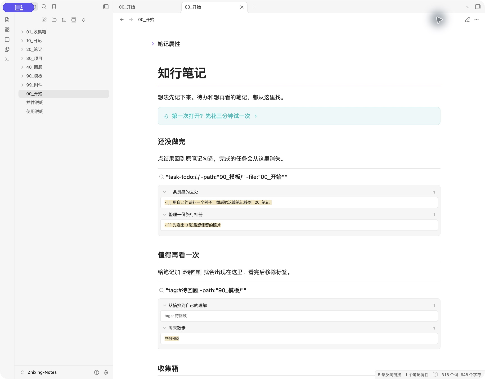

# Zhixing Notes

**An Obsidian starter vault that brings scattered tasks and notes to revisit onto one home page.**

An inbox, daily notes and six templates, already configured. The basic workflow needs no community plugins. **The vault and plugin interfaces are in Chinese.**

**[Download the vault](https://github.com/crown-sports/zhixing-notes/releases/latest/download/Zhixing-Notes.zip)** · [中文](README.md)



- **Capture now, sort later:** new notes go into the inbox.
- **Find unfinished tasks:** write a checkbox in any note; the home page collects it.
- **Revisit useful notes:** add `#待回顾` to a note, then remove the tag when done.

## Try it in three minutes

1. [Install Obsidian](https://obsidian.md/download). Download and extract **Zhixing-Notes.zip** from the link above, rather than GitHub's source ZIP.
2. Choose **Open folder as vault** and select the folder containing `00_开始.md`. If asked to trust the vault, open it in restricted mode to start.
3. Press **Ctrl/Cmd + N**, name the note “Weekend walk”, and paste into its body:

```markdown
Try a new walking route and take a few photos.
- [ ] Charge the camera before leaving

#待回顾
```

Open **00_开始** in the file list. Find your note under “收集箱” (Inbox) and its task under “还没做完” (Unfinished). Open the task's source note, check it off, and return home: the task disappears from the unfinished list.

## Optional desktop plugins

The download includes two plugins, disabled by default:

- **Review Workbench:** write question/answer cards, then hide answers to test your recall.
- **PDF Location Bookmarks:** save the current page or chapter and return to it. Experimental; uses internal Obsidian APIs.

[Enable plugins](vault/插件说明.md) · [Standalone plugin downloads](https://github.com/crown-sports/zhixing-notes/releases/latest)

Already have a vault? Try this one separately, then copy the templates you want. Keep your existing `.obsidian` configuration.

Notes remain local Markdown files. Examples are fictional and can be removed. Mobile operation has not been tested; optional plugins are desktop-only. [Validation and limitations](docs/validation.md).

<details>
<summary>Development</summary>

Node 20+ and Python 3.9+; no project dependencies to install.

```sh
npm run package
npm run check
npm test
```

</details>

[Contributing](CONTRIBUTING.md) · [Changes](CHANGELOG.md) · [MIT](LICENSE) · [Credits](NOTICE)
