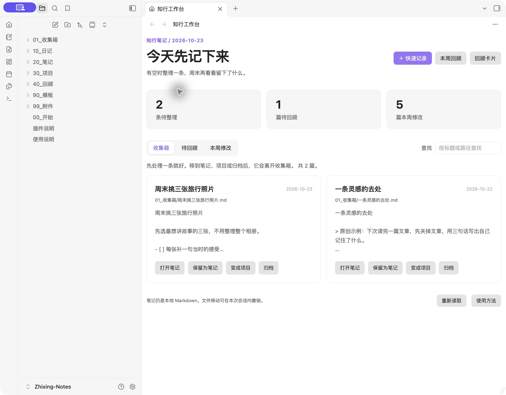

# Zhixing Notes

**Capture a thought, clear your inbox, and look back on your week.**

An Obsidian workbench for capture, organization and weekly review. Your notes stay in local Markdown. **The vault and plugin interfaces are in Chinese.**

**[Download the starter vault](https://github.com/crown-sports/zhixing-notes/releases/latest/download/Zhixing-Notes.zip)** · [中文](README.md)

- **Capture:** write a thought without choosing a title or folder.
- **Organize:** preview inbox notes and move each to notes, projects or archive. Undo the most recent move.
- **Review:** generate a weekly note with links to your inbox, tagged notes and recently modified notes. Reopening the same week preserves your writing.

## Try it

1. [Install Obsidian](https://obsidian.md/download), download and extract `Zhixing-Notes.zip`.
2. Choose **Open folder as vault**, select the folder containing `00_开始.md`, then enable **知行工作台** in Community plugins.
3. Click the house ribbon icon, or use Ctrl/Cmd + P and search for **打开笔记工作台**.

Capture “Pick three travel photos this weekend”, move it to Projects, try Undo, then open the weekly review and write your next step.

Already have a vault? Install only [`review-workbench.zip`](https://github.com/crown-sports/zhixing-notes/releases/latest/download/review-workbench.zip), then choose your folders in plugin settings. Keep your existing vault configuration. The plugin ID remains `review-workbench` for upgrades from 0.1.x.

The starter also works without community plugins using its Markdown home page, daily notes and templates. Optional card self-testing and PDF location bookmarks remain available.

Weekly reviews are link snapshots, not live reports. Link updates on file moves follow Obsidian settings. Plugins are desktop-only; PDF bookmarks use internal APIs and are experimental. [Validation and limitations](docs/validation.md).

Development

Node 20+, Python 3.9+, no project dependencies. Run `npm run package`, `npm run check`, `npm test`.

[Contributing](CONTRIBUTING.md) · [Changes](CHANGELOG.md) · [MIT](LICENSE)
