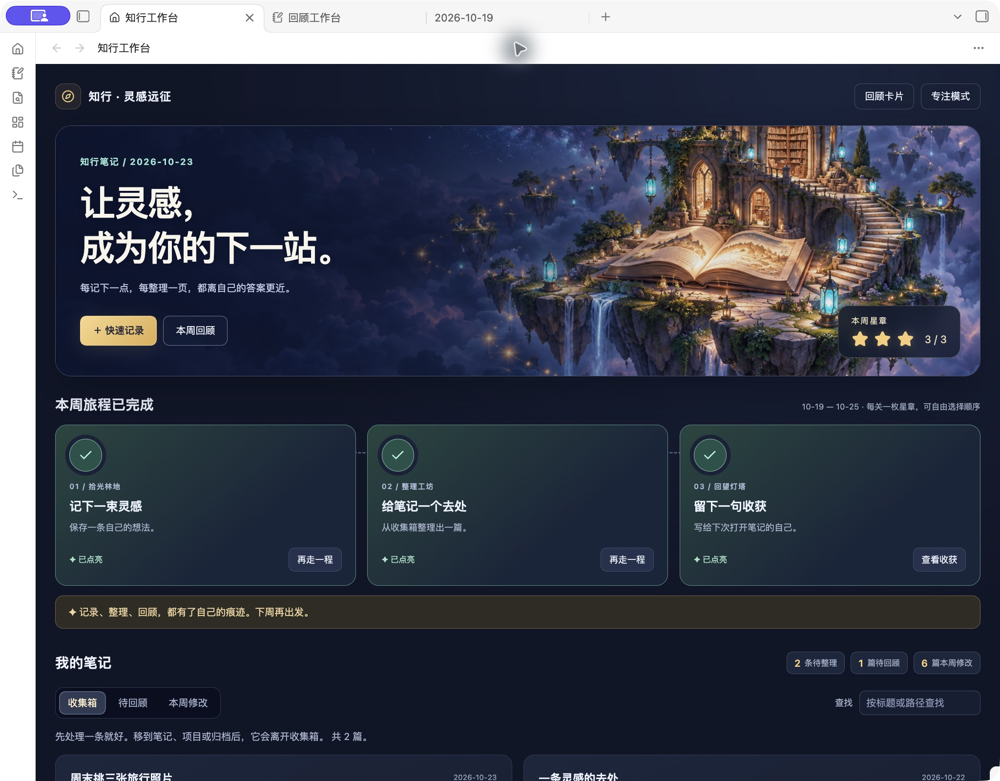

# Zhixing Notes

**Capture a thought, organize a note, and keep one takeaway.**

An Obsidian workbench with a floating study and a three-stop weekly journey. Give scattered notes a home while keeping everything in local Markdown. **The vault and plugin interfaces are in Chinese.**

**[Download the starter vault](https://github.com/crown-sports/zhixing-notes/releases/latest/download/Zhixing-Notes.zip)** · [中文](README.md)

- **Capture:** write a thought without choosing a title or folder.
- **Organize:** preview inbox notes and move each to notes, projects or archive. Undo the most recent move.
- **Review:** start with links to your notes, then save a takeaway in the weekly note. Reopening the same week preserves your writing.

**Three milestones, three stars each week.** Save a thought, organize a note, and save a takeaway of at least 10 non-whitespace characters. Complete them in any order; repeated actions earn no extra stars, and undoing the recorded move removes its star. **Focus mode** hides the scene, follows your Obsidian theme, and remembers your preference.

## Try it

1. [Install Obsidian](https://obsidian.md/download), download and extract `Zhixing-Notes.zip`.
2. Choose **Open folder as vault**, select the folder containing `00_开始.md`, then enable **知行工作台** in Community plugins.
3. Click the house ribbon icon, or use Ctrl/Cmd + P and search for **打开笔记工作台**.

Click **开始记录** to capture “Pick three travel photos this weekend”. Move it to Projects, try Undo, then organize it again. Click **写一句回顾** to save a takeaway. Each star now points to something you actually did.

Already have a vault? Install only [`review-workbench.zip`](https://github.com/crown-sports/zhixing-notes/releases/latest/download/review-workbench.zip), then choose your folders in plugin settings. For upgrades, disable the plugin, replace `main.js`, `manifest.json` and `styles.css`, keep `data.json`, then enable it again. The illustration is bundled; no connection or extra download is needed. [Installation guide (Chinese)](plugins/review-workbench/README.md).

The starter also works without community plugins using its Markdown home page, daily notes and templates. Optional card self-testing and PDF location bookmarks remain available.

Weekly reviews are link snapshots; takeaways are appended to the note. Only the latest 26 weeks of milestones and note paths are kept in local plugin data. No note content is uploaded. Plugins are desktop-only; PDF bookmarks are experimental. [Validation and limitations](docs/validation.md).

Development

Node 20+, Python 3.9+, no project dependencies. Run `npm run package`, `npm run check`, `npm test`.

[Contributing](CONTRIBUTING.md) · [Changes](CHANGELOG.md) · [MIT](LICENSE)
