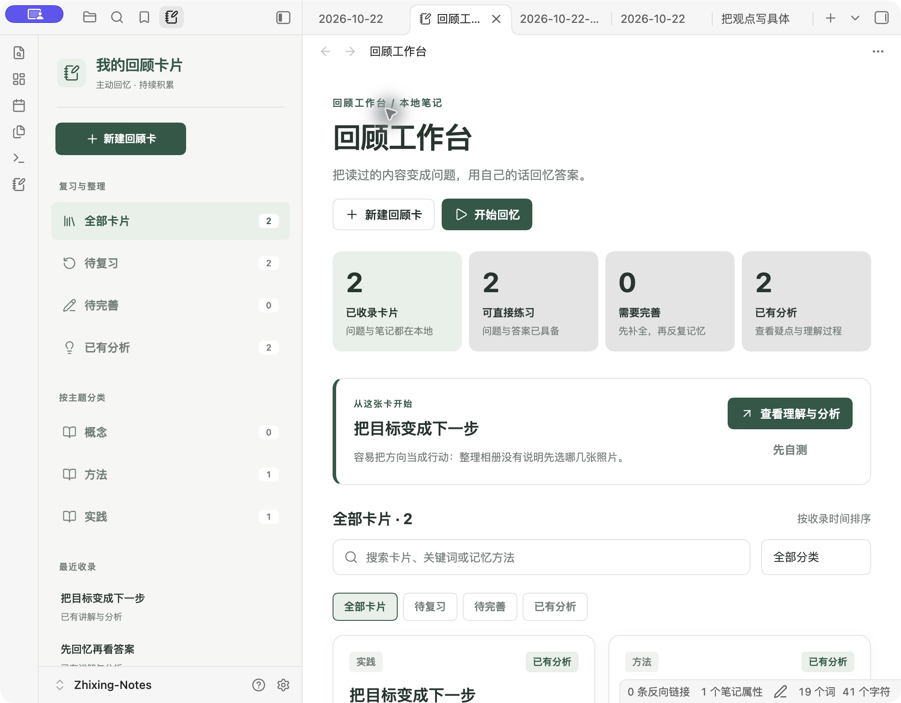
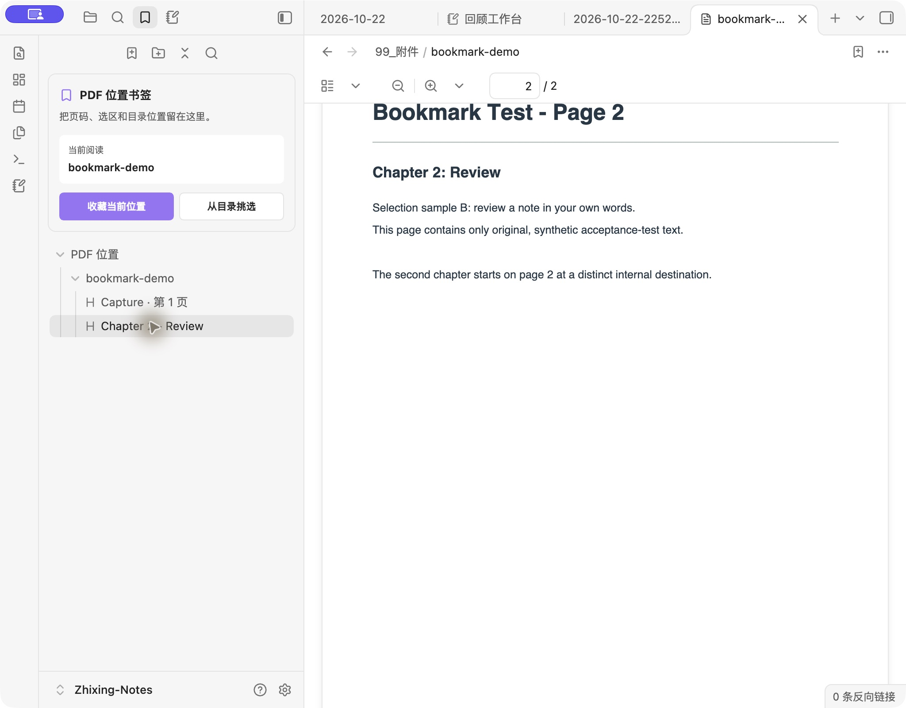

# 知行笔记 · Zhixing Notes

**开箱即用的 Obsidian 中文笔记库：随手记想法，在首页找回待办和待回顾的笔记。**

适合想开始用 Obsidian、又不想先研究插件和目录的人。收集箱、日记和 6 种模板都已配好，基础功能无需安装社区插件。

**[下载笔记库](https://github.com/crown-sports/zhixing-notes/releases/latest/download/Zhixing-Notes.zip)** · [三分钟上手](vault/使用说明.md) · [English](README.en.md)


*任务写在各自的笔记里，首页集中显示；点击结果就能回到原文。*

| 你想做什么 | 打开后怎么用 |
| --- | --- |
| 先记下来，晚点整理 | 新笔记自动放进收集箱；日记已有当天的模板 |
| 找到没做完的事 | 在笔记里写待办，首页自动汇总未完成项 |
| 回头看看读过的内容 | 给笔记加 `#待回顾`，首页就能找到；看完移除标签 |

## 三分钟开始

先[安装 Obsidian](https://obsidian.md/download)。这里的“库”就是一个存放笔记的文件夹。

1. **[下载 Zhixing-Notes.zip](https://github.com/crown-sports/zhixing-notes/releases/latest/download/Zhixing-Notes.zip)** 并解压。用这个安装包，不用 GitHub 的 `Code → Download ZIP`。
2. 在 Obsidian 选择 **打开本地仓库 / Open folder as vault**，选中包含 `00_开始.md` 的 `Zhixing-Notes` 文件夹。若出现信任提示，先以安全模式打开即可。
3. 按 **Ctrl / ⌘ + N** 新建笔记，命名为“周末散步”，在正文粘贴：

```markdown
想走一条没去过的路线，拍几张照片。
- [ ] 出门前给相机充电

#待回顾
```

打开左侧的 **00_开始**：这条笔记会出现在“收集箱”，任务会出现在“还没做完”。点结果回到原笔记，勾选任务，再回首页——它就从未完成列表消失了。

[日记、模板和常见问题 →](vault/使用说明.md)

## 用熟之后再加插件

| 可选工具 | 用处 |
| --- | --- |
| [回顾工作台](plugins/review-workbench/README.md) | 把读过的内容写成问题，遮住答案自测 |
| [PDF 位置书签](plugins/pdf-location-bookmarks/README.md) | 保存当前页或章节，下次接着读（桌面实验功能） |

<details>
<summary>查看界面和启用方法</summary>





安装包已包含两个插件，默认关闭。[按步骤启用 →](vault/插件说明.md)
已有笔记库可下载[独立插件包](https://github.com/crown-sports/zhixing-notes/releases/latest)，无需替换原库配置。

</details>

笔记是本地 Markdown 文件，示例均为虚构，可删除。基础功能使用 Obsidian 核心插件；手机操作尚未实测，两个可选插件仅限桌面。[验证范围](docs/validation.md)

<details>
<summary>开发与贡献</summary>

Node 20+、Python 3.9+，无需安装项目依赖。

```sh
npm run package
npm run check
npm test
```

安装包及校验和生成在 `dist/`。[贡献指南](CONTRIBUTING.md) · [README 设计参考](docs/readme-design.md)

</details>

[更新记录](CHANGELOG.md) · [MIT](LICENSE) · [致谢](NOTICE)
