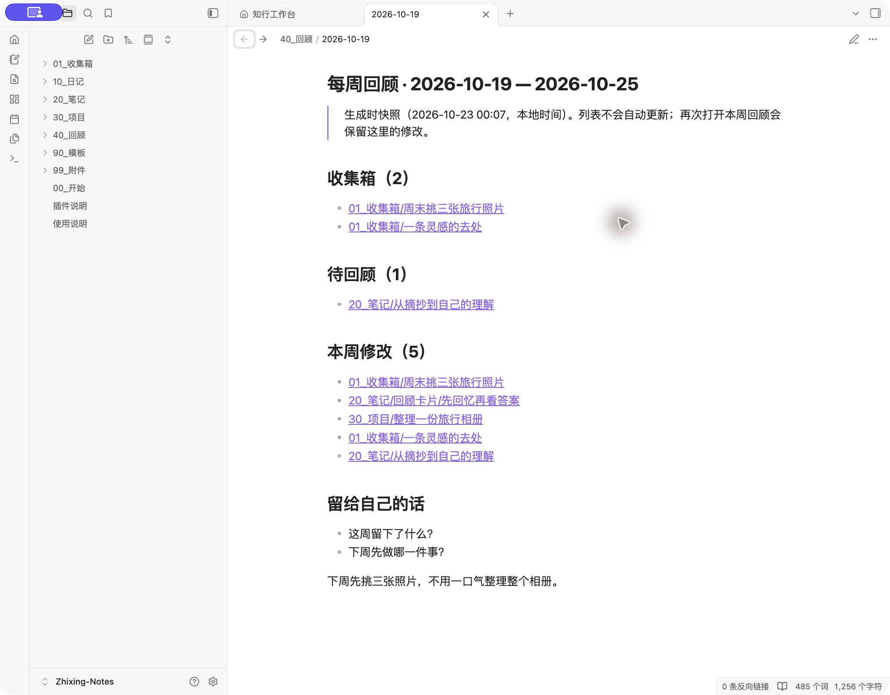

# 知行笔记 · Zhixing Notes

**记下一个想法，整理一篇笔记，留下一句收获。**

给 Obsidian 用的中文笔记工作台。在浮空书房里走完本周三站，让零散记录有去处。笔记始终是本地 Markdown。

**[下载体验库](https://github.com/crown-sports/zhixing-notes/releases/latest/download/Zhixing-Notes.zip)** · [已有库安装](plugins/review-workbench/README.md) · [English](README.en.md)


| 平时遇到的问题 | 在这里怎么做 |
| --- | --- |
| 想记一句话，不想先取标题、选目录 | **快速记录**，只写正文也能存进收集箱 |
| 零散笔记越积越多，不知道怎么处理 | 看一条预览，**保留为笔记 / 变成项目 / 归档**；移错了能撤销 |
| 到周末想回顾，却不知道从哪里开始 | **本周回顾**自动带入笔记链接；补写自己的总结，下次打开仍保留 |

**本周三站，每站一星。** 记录一个想法、整理一篇笔记、写下至少 10 字的周收获。不必按顺序；撤销对应整理会退星。想安静写作，可切到 **专注模式**。

## 三分钟试一次

1. [安装 Obsidian](https://obsidian.md/download)，下载并解压上面的 `Zhixing-Notes.zip`。
2. 选择 **打开本地仓库**，打开包含 `00_开始.md` 的文件夹。在“设置 → 第三方插件 / 社区插件”启用 **知行工作台**。
3. 点击左侧 **房子图标**，或按 **Ctrl / ⌘ + P** 搜索 **打开笔记工作台**。

点“开始记录”，写下“周末挑三张旅行照片”。在收集箱把它移为项目，试一次“撤销移动”再整理。最后点“写一句回顾”，保存“这周先整理旅行照片，下周做一本小相册”。三颗星都有对应的笔记。

<details>
<summary>看看生成的周回顾</summary>



</details>

不用插件也能用首页、日记和模板。[基础用法与常见问题 →](vault/使用说明.md)

## 已经有自己的笔记库？

只安装 [`review-workbench.zip`](https://github.com/crown-sports/zhixing-notes/releases/latest/download/review-workbench.zip)，在插件设置中选择自己的目录即可。更新时保留 `data.json`；插画已包含在插件内，无需联网或额外下载。[安装步骤 →](plugins/review-workbench/README.md)

<details>
<summary>还可以做什么？</summary>

- **读完自测**：把内容写成问题和答案，在工作台点“回顾卡片”开始回忆。
- **PDF 接着读**：可选启用“PDF 位置书签”，保存当前页或章节。
- **日记与模板**：体验库已配好 6 种模板，基础用法只需要 Obsidian 核心功能。


[插件说明](vault/插件说明.md)

</details>

周回顾是链接快照；周收获追加到原文。旅程只在本地保留最近 26 周的阶段与笔记路径，不上传内容。插件仅支持桌面；PDF 书签属于实验功能。[验证范围](docs/validation.md)

<details>
<summary>开发与贡献</summary>

Node 20+、Python 3.9+，无需安装项目依赖。

```sh
npm run package
npm run check
npm test
```

[贡献指南](CONTRIBUTING.md) · [产品研究与取舍](docs/product-decisions.md) · [README 设计参考](docs/readme-design.md)

</details>

[更新记录](CHANGELOG.md) · [MIT](LICENSE) · [致谢](NOTICE)
