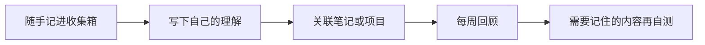

# 知行笔记 · Zhixing Notes

**把零散想法记下来，整理成自己的笔记，之后还能找回来、用起来。**

一份可直接打开的 Obsidian 示例库，附两个可选桌面插件。基础流程只用核心功能，没有 API Key 或必装的社区插件。

[下载示例库](https://github.com/crown-sports/zhixing-notes/releases/latest/download/Zhixing-Notes.zip) · [English](README.en.md) · [三分钟上手](vault/使用说明.md) · [插件说明](vault/插件说明.md)




## 打开就能用

1. 下载并解压 **Zhixing-Notes.zip**。
2. 在 Obsidian 中选择“打开本地仓库”，打开解压后的 `Zhixing-Notes` 文件夹。
3. 打开 `00_开始.md`，写第一条笔记。日记、模板、附件路径已配置。

新笔记默认进入收集箱；首页汇总未完成任务和待回顾内容。六种模板覆盖日记、普通笔记、阅读、项目、每周回顾与回顾卡片。示例均为原创虚构内容，可删除。

## 按需多做一点

| 工具 | 解决什么问题 |
| --- | --- |
| **回顾工作台** | 把问题和答案存为 Markdown，按分类查找、先回忆再看答案；补充分析时检测编辑冲突 |
| **PDF 位置书签** | 收藏当前页或章节，回到原来的阅读位置；已有书签由 Obsidian 原生管理 |

<details>
<summary>查看插件实际界面</summary>


截图来自独立示例库，演示卡片与 PDF 均为合成内容。

</details>

完整包已包含这两个插件，默认关闭，在社区插件设置中按需启用。
安装到已有库时，使用 [独立插件 ZIP](https://github.com/crown-sports/zhixing-notes/releases/latest)，无需覆盖整库配置。

间隔复习可接入 [Spaced Repetition](https://github.com/st3v3nmw/obsidian-spaced-repetition)；PDF 文字选区和批注可接入 [PDF++](https://github.com/RyotaUshio/obsidian-pdf-plus)。第三方插件需自行安装。

## 数据始终是文件

笔记、卡片和附件保存在本地。停用插件仍可编辑；没有自动上传或 AI 请求。
此仓库只包含整理后的配置、源码和示例，不包含作者的个人笔记、账号配置、工作材料或第三方插件二进制。

基础库面向桌面和移动端；两个插件初版仅面向桌面。PDF 插件使用内部接口，属于实验功能。[验证范围与已知限制](docs/validation.md)。

## 开发

Node 20+、Python 3.9+，没有需要安装的项目依赖。

```sh
npm run package
npm run check
npm test
```

安装包及校验和生成在 `dist/`。`vault/` 是经过整理的发布源，打包工具不会扫描或导出个人库。

[贡献指南](CONTRIBUTING.md) · [更新记录](CHANGELOG.md) · [MIT](LICENSE) · [致谢](NOTICE)
